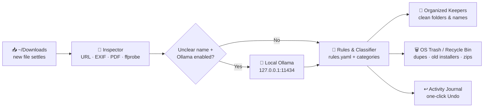

<div align="center">

# ✦ TidyDrop

**Downloads folders always turn into chaos. TidyDrop automatically sorts, renames (optionally with local AI), and clears out clutter so only the files you want to keep remain.**

[](https://github.com/walidriachy/tidydrop/actions/workflows/build.yml)
[](https://github.com/walidriachy/tidydrop/releases/latest)
[](LICENSE)


[**Download**](https://github.com/walidriachy/tidydrop/releases/latest) ·
[**Website & Live Preview**](https://www.appx.ae/downloads/tidydrop) ·
[**Beginner guide**](docs/GUIDE.md) ·
[Rules & AI](docs/RULES.md) ·
[Roadmap](ROADMAP.md) ·
[Security](SECURITY.md) ·
[Contributing](CONTRIBUTING.md)

</div>

---

Every Mac and Windows `Downloads` folder eventually turns into a graveyard of hundreds of random PDFs (`scan0001.pdf`), duplicate archives (`file (2).zip`), cryptic video filenames, and forgotten `.dmg` / `.exe` installers. **TidyDrop was built to fix that for good.**

It runs quietly in your **macOS menu bar** or **Windows system tray**. Every new download is checked once finished, renamed clearly from its metadata or optional local Ollama AI, sorted into clean sub-folders, and stripped of duplicate copies and old installers so your `Downloads` folder stays permanently clean with **only the files you actually want to keep**.

* **Never permanently deletes anything** — every removed duplicate, extracted zip, or expired installer goes safely to your Recycle Bin / Trash.
* **One-click Undo** — every move is logged in a reversible journal.
* **100% local & private** — zero cloud uploads, zero accounts, zero telemetry.

## Contents

- [Before & after](#before--after)
- [Features](#features)
- [How it works](#how-it-works)
- [Quick start](#quick-start)
- [Rules & local AI](#rules--local-ai)
- [Command line & developers](#command-line--developers)
- [Project status & roadmap](#project-status--roadmap)
- [Security](#security)
- [Contributing](#contributing) · [License](#license)

## Before & after

```text
BEFORE (messy Downloads)                    AFTER (TidyDrop — keepers only)
─────────────────────────────────────────   ──────────────────────────────────────────────────
scan0001.pdf                                Downloads/
scan0001 (1).pdf          (duplicate)       ├── Documents/
Untitled video (2).mp4                      │   └── Invoices/2026-11-20 Adobe Invoice.pdf
wetransfer_assets_99a1.zip                  ├── Videos/
ChromeSetup (3).dmg       (old installer)   │   └── 2026-11-18 Product Demo 1080p 3min.mp4
IMG_4821.HEIC                               ├── Transfers/
                                            │   └── 2026-11/Brand Kit Assets/   (unzipped)
                                            ├── Images/
                                            │   └── 2026-11-14 Studio Shoot.heic
                                            └── Installers/                     (auto-cleared after 14 days)
                                            (duplicates & extracted .zips → Trash / Recycle Bin)
```

## Features

| | |
|---|---|
| ⏳ **Waits for downloads to finish** | Ignores `.crdownload`, `.part`, and in-progress files. Only touches a file after it stops growing and nothing holds it open |
| 🌐 **Source-URL aware** | Reads the download URL Windows (`Zone.Identifier`) and macOS (`com.apple.quarantine`) store on each file so rules like "WeTransfer → `Transfers/{month}`" work automatically |
| 🔎 **Deep metadata extraction** | Reads PDF, Word, and PowerPoint titles/text, camera EXIF dates, and video resolution & duration (via `ffprobe` if installed) |
| 🏷️ **Smart renaming** | Turns `Untitled video (2).mp4` into `2025-10-12 Untitled video 1080p 3min.mp4` while keeping installers, code, and fonts untouched |
| 🧠 **Optional local AI (Ollama)** | Sends unclear filenames like `scan0001.pdf` to a local model on `127.0.0.1:11434` (`2026-11-20 Adobe Creative Cloud Invoice.pdf`). Zero cloud egress |
| 📦 **Safe auto-unzip** | Extracts `.zip` and `.tar.gz` safely with zip-slip & zip-bomb guards, sends the archive to Trash, and preserves the OS internet warning mark on extracted files |
| 🧹 **Clutter & duplicate cleanup** | Moves exact SHA-256 duplicate copies (`file (1).pdf`) and installers older than 14 days (`.exe .msi .dmg .pkg`, configurable) safely to Trash |
| ↩️ **Full Activity Log & Undo** | Every action is recorded in `activity.jsonl` and reversible with one click from the tray menu, Settings window, or CLI (`--undo`) |
| 👁️ **Preview mode (Dry run)** | Test rules safely without moving a single file — preview every planned rename and destination right inside the Activity log |
| 🛡️ **Trash-only safety** | Uses OS Trash / Recycle Bin (`Send2Trash`) exclusively. TidyDrop never permanently erases files |

## How it works



## Quick start

Download the latest installer from [**GitHub Releases**](https://github.com/walidriachy/tidydrop/releases/latest) or [**appx.ae/downloads/tidydrop**](https://www.appx.ae/downloads/tidydrop):

### macOS (`TidyDrop.dmg`)

1. Download and open [**`TidyDrop.dmg`**](https://github.com/walidriachy/tidydrop/releases/latest/download/TidyDrop.dmg) and drag **TidyDrop** into **Applications**.
2. Launch it once using **right-click → Open** (open-source releases are not notarized with a paid Apple Developer certificate yet).
3. Click **Allow** when macOS asks for access to your `Downloads` folder. TidyDrop runs quietly in your menu bar with no Dock icon.

### Windows (`TidyDrop.Setup.exe`)

1. Download and run [**`TidyDrop.Setup.exe`**](https://github.com/walidriachy/tidydrop/releases/latest/download/TidyDrop.Setup.exe) (no administrator password required).
2. If Windows SmartScreen displays *"Windows protected your PC"*, click **More info → Run anyway**.
3. Click **Install**. TidyDrop appears in your system tray by the clock — right-click for **Settings & activity log**, **Pause**, **Preview mode**, **Undo**, and **Start at login**.

> **Tip:** Want to see what TidyDrop will do before moving anything? Turn on **Preview mode** in the tray menu first — nothing is moved while Preview mode is active.

Full walkthrough & troubleshooting: [**docs/GUIDE.md**](docs/GUIDE.md).

## Rules & local AI

Click **Edit rules...** in the tray menu to open `rules.yaml` (reloads automatically on save):

```yaml
rules:
  - name: Bank statements
    when:
      extensions: [pdf]
      text_contains_any: [statement, "account number"]
    move_to: Documents/Bank/{year}

  - name: Big videos
    when:
      category: Videos
      min_size_mb: 2000
    move_to: Videos/Large
    expire_days: 60
```

### Enable optional local AI renaming

1. Install [Ollama](https://ollama.com) locally.
2. Pull a fast local model: `ollama pull llama3.2`
3. Open **Settings → AI renaming**, enable **Use AI to name documents**, click **Find models**, and test on a sample invoice.

Full rules & template documentation: [**docs/RULES.md**](docs/RULES.md).

## Command line & developers

### CLI options

```bash
python -m tidydrop                    # start with menu bar / system tray icon
python -m tidydrop --settings         # open the Settings & Activity window
python -m tidydrop --once             # organize existing Downloads once and exit
python -m tidydrop --once --dry-run   # preview what would happen without moving files
python -m tidydrop --undo             # undo the last organized action
python -m tidydrop --no-tray          # run in terminal (Ctrl+C to stop)
python -m tidydrop --config-dir PATH  # use a custom settings directory
```

### Configuration & log locations

| Data | macOS | Windows |
|---|---|---|
| Settings, rules & activity log | `~/Library/Application Support/TidyDrop` | `%APPDATA%\TidyDrop` |

### Run & test from source

```bash
python3 -m venv .venv
source .venv/bin/activate             # Windows: .\.venv\Scripts\activate
python -m pip install -r requirements-dev.txt
python -m pytest -q
python run.pyw
```

### Build installers locally

- **macOS:** `bash scripts/build_mac.sh` → `dist/TidyDrop.dmg`
- **Windows:** `.\scripts\build_windows.ps1` → `dist\TidyDrop Setup.exe`

## Project status & roadmap

See [**ROADMAP.md**](ROADMAP.md) for shipped capabilities and upcoming releases, and [**CHANGELOG.md**](CHANGELOG.md) for version history.

## Security

TidyDrop is designed to be local-only, reversible, and archive-safe. Read [**SECURITY.md**](SECURITY.md) for our privacy guarantees, zip-bomb/zip-slip protections, and private vulnerability reporting process.

## Contributing

Bug reports, new rule ideas, documentation fixes, and pull requests are welcome. Please read [**CONTRIBUTING.md**](CONTRIBUTING.md) and our [**Code of Conduct**](CODE_OF_CONDUCT.md) first.

## License

[MIT License](LICENSE) · Engineered in Dubai by [**Appx**](https://www.appx.ae) (a software division of Bodykits Aerodynamics LLC).
